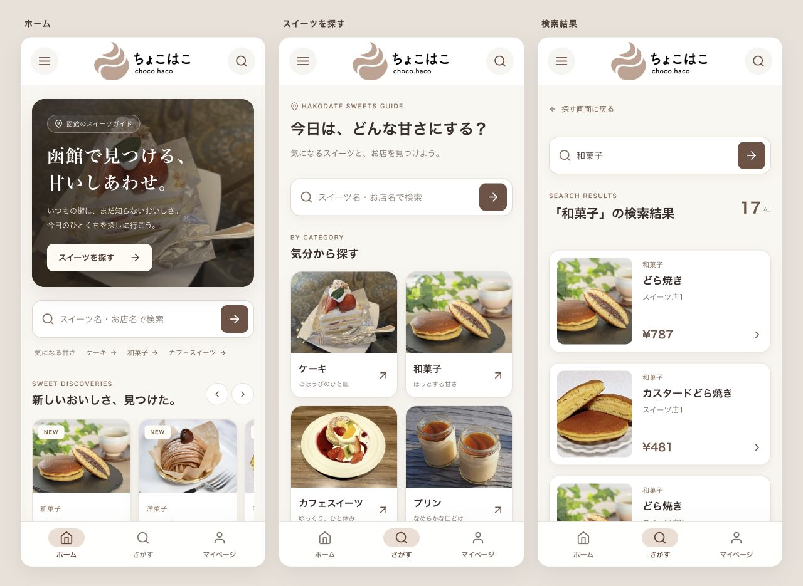

# ちょこはこ — 函館のスイーツガイド

函館のスイーツを、写真やカテゴリから探すWebアプリです。React / TypeScriptのフロントエンドと、Expressの開発用APIで構成しています。

## デザイン確認

「ちょこはこ」ロゴを使い、モカ色とクリーム色を基調に、ホーム・検索・検索結果・店舗詳細・メニューの見た目を統一しました。



- 写真を大きく見せるホームと、横スクロールできる商品カード
- 写真付きカテゴリ、キーワード検索、価格が読みやすい結果一覧
- アイコン付き下部ナビと、背景クリック・閉じるボタン・Escキーに対応したメニュー
- スマートフォンとデスクトップに対応した文字・余白・カード配置
- ロゴとカテゴリ写真は `frontend/public` 内のファイルを利用

## 手元で動かす

確認環境は Node.js 24 です。2つのターミナルでAPIと画面を起動してください。

**1. APIを起動**

```sh
cd backend
npm ci
npm run dev
```

**2. 画面を起動**

```sh
cd frontend
npm ci
npm run dev
```

ブラウザーで **http://localhost:5173/home** を開きます。APIは `http://localhost:3000` を使用します。APIの接続許可は `http://localhost:5173` に設定されているため、`127.0.0.1` や別のポートで画面を開くとデータを取得できません。

## 確認済み

- `frontend` の `npm run build`
- 変更したTSXファイルのESLintチェック
- 320px・390px幅とデスクトップでの表示確認
- カテゴリ検索、検索結果0件の表示、店舗詳細への移動
- メニューの背景クリック・閉じるボタン・Escキー

## 現在のデータ・機能

開発用のサンプルデータを使用しています。店舗詳細はまだ店舗ごとのAPI情報には連動していません。お気に入り保存と設定は準備中です。

特集記事のリンク先・一部の特集写真・出店写真は元データ側で未用意です。写真を取得できない場合は「画像準備中」と表示します。期間限定出店には過去の日程を含むサンプルデータが入っているため、公開運用前に更新してください。

このリポジトリのプッシュはソースコードと確認画像の共有です。インターネットで操作できる公開サイトには、APIを含む別途の公開設定が必要です。
